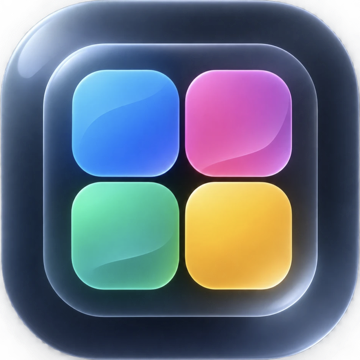
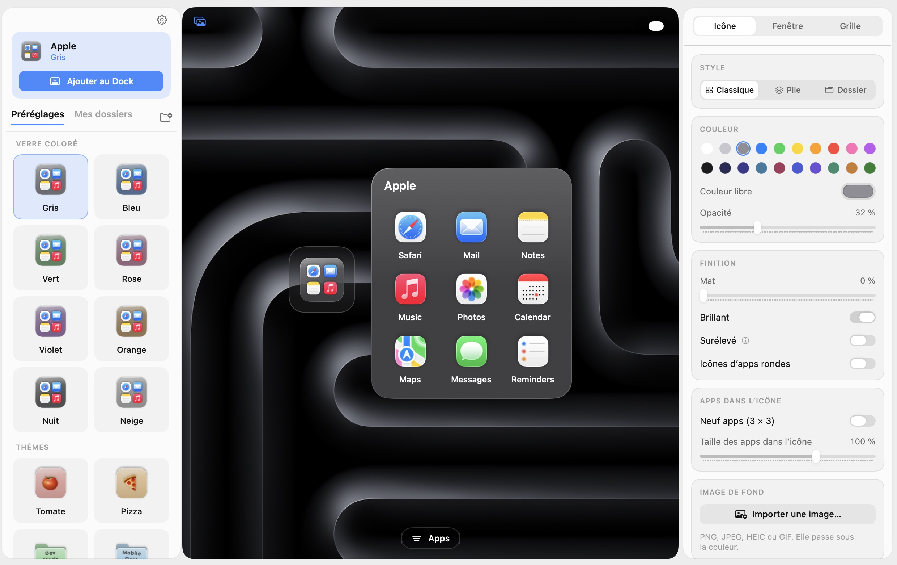
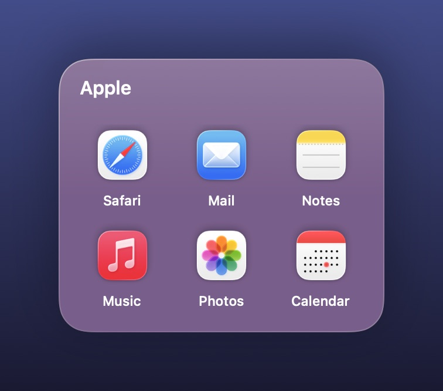
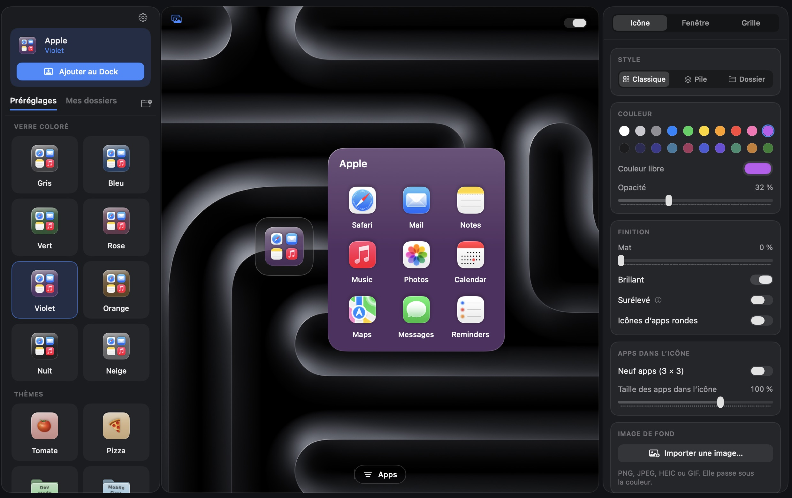

<p align="center">
  
</p>

<h1 align="center">Groop pour Droppy</h1>
<p align="center">Des dossiers d'apps dans votre Dock, qui s'ouvrent en grille de verre.</p>
<p align="center">
  <a href="https://github.com/Nicolasdellim/groop/releases/latest">Télécharger le Droplet</a> ·
  <a href="#installation">Installation</a> ·
  <a href="#utilisation">Utilisation</a> ·
  <a href="https://github.com/Nicolasdellim/groop/issues">Signaler un problème</a>
</p>
<p align="center">
  <strong>Version 1.1.0</strong> · macOS 14+ · Droppy 15.3+ · Apple Silicon et Intel
</p>

Groop est un droplet macOS pour [Droppy](https://getdroppy.app/) qui range plusieurs apps derrière une seule tuile du Dock. Un clic sur la tuile, et le dossier s'ouvre juste au-dessus, en fenêtre de verre avec ses apps en grille, en liste ou en tuiles, sur autant de pages qu'il faut.

<p align="center">
  
  <br />
  <em>Le studio : les préréglages à gauche, l'aperçu sur votre fond d'écran au centre, tous les réglages à droite.</em>
</p>

## Fonctionnalités

| | Ce que vous pouvez faire |
| --- | --- |
| **Préréglages** | Verre coloré, thèmes (Tomate, Pizza, Dev Mode, Musique, Jeux, Travail…), bonbons, et un bouton pour mélanger les styles. |
| **Icône du Dock** | Grille classique (4 ou 9 apps), pile de cartes ou dossier avec symbole, texte ou emoji. Couleur, opacité, mat, brillance, ombre, image de fond. |
| **Fenêtre** | Couleur propre, surface (verre, givre, grain, éclats), en-tête, bouton « Tout ouvrir », police, image avec parallaxe, arrondi. |
| **Grille** | Disposition automatique ou colonnes × rangées au choix, vue icônes, liste ou tuiles, pages supplémentaires. |
| **Tailles exactes** | Icônes de 28 à 120 px, titre, noms, écarts, marges et taille de la fenêtre, au pixel près. |
| **Directement à l'écran** | Pincez la fenêtre, faites ⌘+ / ⌘−, ou tirez son coin pour la redimensionner. Choisissez où elle s'ouvre : près du Dock, au centre, au pointeur, ou là où vous l'avez laissée. |
| **Sélecteur d'apps** | Recherche, tri par catégories ou A→Z, vue en liste ou en cartes, glisser-déposer, renommer ou masquer une app. |
| **Raccourcis clavier** | Un raccourci par dossier pour l'ouvrir de n'importe où, et un pour le studio. |
| **Command Center** | Une tuile dans le Command Center de Droppy avec les dossiers de votre choix. |
| **Thème** | Clair, sombre ou système, avec la couleur d'accent de votre choix. |

<p align="center">
  
  <br />
  <em>Un dossier ouvert depuis le Dock.</em>
</p>

## Installation

**Prérequis :** macOS 14 ou plus récent et [Droppy](https://getdroppy.app/) 15.3 ou plus récent. Le bundle est universel Apple Silicon / Intel ; l'interface est en anglais ou en français, selon la langue du Mac.

1. Télécharger **Groop-1.1.0.droplet.zip** depuis les [releases](https://github.com/Nicolasdellim/groop/releases/latest), puis décompresser l'archive.
2. Dans Droppy → Réglages → Droplet Store → Local droplets, importer `Groop.droplet` et approuver le build.
3. Quitter puis relancer Droppy si une ancienne version était déjà chargée.

## Utilisation

1. Dans Droppy → Réglages → Groop, cliquer sur **Ouvrir le studio**.
2. Créer un dossier, choisir un préréglage, puis ouvrir le sélecteur avec **Apps** et cliquer sur les apps à ajouter.
3. Affiner l'icône, la fenêtre et la grille dans l'inspecteur (l'interrupteur en haut à droite de l'aperçu active le mode créateur).
4. Cliquer sur **Ajouter au Dock**. Le Dock se recharge environ une seconde.
5. Cliquer sur la tuile dans le Dock : le dossier s'ouvre au-dessus. Échap ou un clic ailleurs le referme ; un clic droit permet de le détacher, de changer sa taille ou l'endroit où il s'ouvre.

Les réglages de la fenêtre et de la grille s'appliquent tout de suite. Après un changement de l'icône, le studio propose **Actualiser dans le Dock**.

<p align="center">
  
  <br />
  <em>Le même studio en thème sombre.</em>
</p>

## Confidentialité

- **global-shortcuts** : raccourcis clavier optionnels, un par dossier et un pour le studio.
- **menu-bar** : la tuile Groop du Command Center de Droppy, seulement si vous y épinglez un dossier.
- Les dossiers sont stockés dans le conteneur de Groop, dans celui de Droppy : un fichier `groop.json`, les images importées, et une petite app « lanceur » par dossier épinglé, que le Dock affiche. Un clic sur ce lanceur ouvre le dossier dans Groop.
- Pour placer un dossier, Groop modifie les préférences du Dock (`com.apple.dock`, `persistent-apps`) puis relance le Dock. Une copie de ces préférences est gardée avant chaque changement (les dix dernières).
- Aucun accès réseau. Rien ne quitte le Mac.

## Construction

<details>
<summary>Compiler et valider le Droplet depuis les sources</summary>

**Outils requis :** macOS 14+, Xcode 26 / Swift 6.2+, Droppy 15.3+, DroppyKit 1.22+.

Cloner [DroppyKit](https://gitlab.com/droppyformac1/droppykit) puis, depuis ce dossier :

```sh
/path/to/droppykit/Scripts/droppykit build
/path/to/droppykit/Scripts/droppykit validate
/path/to/droppykit/Scripts/droppykit run    # harnais de développement
```

Le bundle universel Apple Silicon / Intel est lié au framework DroppyKit fourni par Droppy.

</details>

## Contribuer

Les signalements et propositions sont les bienvenus. Pour un bug, indiquez les versions de macOS et de Droppy, les étapes pour le reproduire et le résultat attendu. Les modifications de code peuvent être proposées par pull request.

## Crédits

L'interface s'inspire de l'app Tiny Folder, avec l'accord de son créateur. Groop est une réécriture indépendante en Swift pour Droppy.

## Contributeurs

- **Nicolas Delli Muti** ([Vision Studio](https://vision-studio.be)) : idée, design, retours et validation.
- **Claude Code (Anthropic)** : développement, tests et documentation, en collaboration avec Nicolas.

## Licence

[MIT](LICENSE). Droppy et DroppyKit sont des projets distincts, soumis à leurs propres licences. Ce projet communautaire est indépendant de Droppy.
